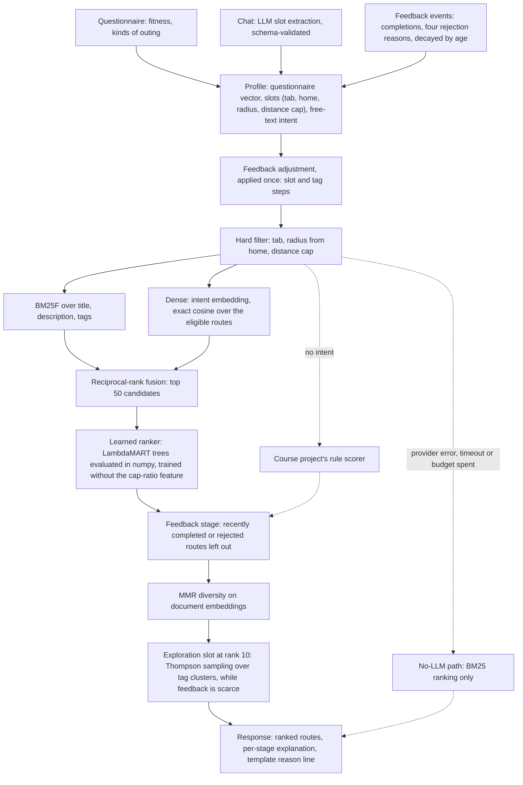
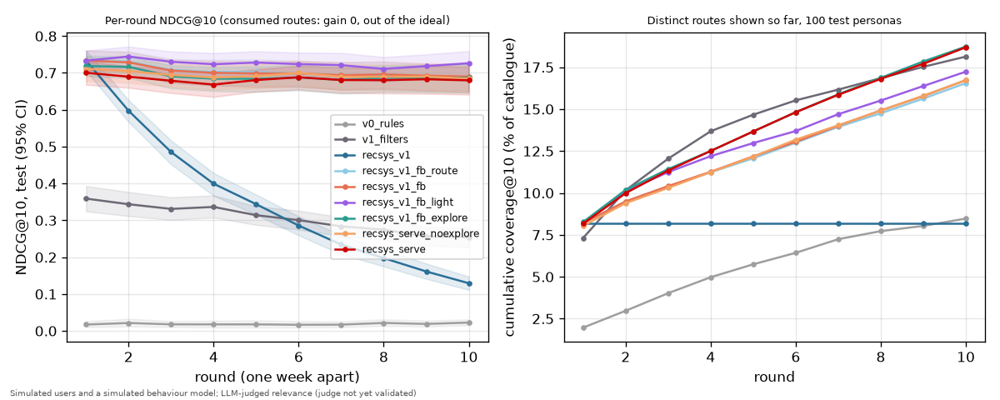

# Outdoor route recommender: from a rule-based course project to an evaluated multi-stage recommender

This repository extends a university course project (a FastAPI + Next.js app that recommended hiking and
cycling routes with a hand-tuned rule score) into a multi-stage recommender over OpenStreetMap routes in
Bavaria, with the evaluation built before any model. Verifiable constraints decide which routes are eligible,
BM25 and dense retrieval fused by reciprocal rank propose candidates, a learned ranker orders them, MMR and one
exploration slot shape the final list, and every stage of every recommendation is explained. There are no real
users yet, so every result comes from simulated users and an LLM judge, and is reported with that caveat and
with bootstrap confidence intervals, generated from the committed results files and replayable without
credentials.

<!-- BEGIN GENERATED readme-headline (make report; do not edit) -->
On the 100 held-out test personas, the served default `recsys_serve` reaches **NDCG@10 0.720 [0.688, 0.748]**, against 0.018 [0.010, 0.026] for the course project's rule scorer and 0.017 [0.010, 0.027] for random order. The best single-request system, `recsys_v1`, reaches 0.755 [0.729, 0.780]; the served default differs from it by -0.035 [-0.053, -0.020] (paired), a cost accepted on purpose for robustness to how real users fill in the form and for an exploration slot ([D25](docs/DECISIONS.md)). In a ten-round feedback simulation the served default keeps NDCG@10 at 0.679 [0.648, 0.710] over rounds 2-10, while the same pipeline without feedback falls to 0.314 [0.291, 0.336] because it keeps showing routes the user has already done.

**Caveat on every number in this README:** the users are simulated (300 personas with LLM-written requests), relevance is graded by an LLM judge (`gemini-3.5-flash`, rubric v1) that is **not yet validated against the owner's labels**, and the only agreement figure so far is LLM-vs-LLM (QWK 0.76). 95% bootstrap intervals over personas in brackets.
<!-- END GENERATED readme-headline -->

**Contents:** [What it does](#what-it-does) · [Architecture](#architecture) · [Results](#results) ·
[Feedback simulation](#feedback-simulation) · [Failure analysis](#failure-analysis) ·
[Limitations](#limitations) · [With real traffic](#what-would-change-with-real-traffic) ·
[Costs and latency](#costs-and-latency) · [How to run it](#how-to-run-it) · [Documentation](#documentation) ·
[Project history](#project-history)

## What it does

A user answers a short questionnaire (fitness, kinds of outing), gives a home town, a travel radius and a
distance cap, and describes the outing in their own words, either in a free-text box or in a chat whose LLM turns
the message into validated profile slots. The app returns a ranked list of routes from the catalogue, each with a
one-line reason and a "Why this?" view that shows what every stage contributed: which constraints it passed,
which words matched, how close in meaning it was, which ranker features lifted or held it back, and whether it
is the exploration pick. Completed routes and four kinds of rejection ("too hard", "too easy", "too far",
"not interested") feed back into the next list. The course project's gamification (stories, quests, souvenirs)
is still there; its LLM-written texts (welcome and route summaries) are now pre-generated and checked against the
route facts.

<!-- BEGIN GENERATED readme-data (make report; do not edit) -->
Catalogue: 9,347 routes. Simulated users: 300 personas (200 dev for every choice and all training, 100 test for reporting only). Judgements: 24,160 (persona, route) pairs, 39% graded 0 by rule (hard-constraint violations), the rest by the LLM judge.
<!-- END GENERATED readme-data -->

The catalogue is built reproducibly from a Geofabrik extract (`make data`); route descriptions are generated
from OSM facts and labelled as generated ([DATA.md](docs/DATA.md)).

## Architecture

What the API serves (`recsys_serve`, [DECISIONS.md](docs/DECISIONS.md) D25); stage design in
[RECSYS.md](docs/RECSYS.md), serving and fallbacks in [SERVING.md](docs/SERVING.md).



Principle, kept in code and docs: **similarity proposes, verifiable constraints decide eligibility, and every
stage reports its contribution.** Each stage can be switched by configuration, and every row in the results
below is a complete registered system selected by name (`make eval SYSTEM=<name>`).

## Results

Ablation on the held-out test split: each row adds one component to the row above (the dense row replaces BM25,
the RRF row fuses both), then the Phase 3 default and the served default. Protocol: [EVAL.md](docs/EVAL.md).

<!-- BEGIN GENERATED readme-results (make report; do not edit) -->
*Simulated users (300 personas, LLM-written intents); LLM-judged relevance (judge `g35f-min-b8` = `gemini-3.5-flash`, rubric/v1); the judge is **not yet validated against the owner's labels**.*

| System | What it adds | NDCG@10 | Δ NDCG@10 vs | MRR@10 | Recall@50 | Violations@10 | Cost/request |
|---|---|---|---|---|---|---|---|
| `random` | random | 0.017 [0.010, 0.027] | – | 0.036 [0.008, 0.073] | 0.017 [0.010, 0.025] | 93.1% [91.3%, 94.6%] | 0.000000 USD |
| `v0_rules` | course project's rule scorer | 0.018 [0.010, 0.026] | +0.000 [-0.011, +0.011] (`random`) | 0.035 [0.011, 0.065] | 0.048 [0.032, 0.064] | 93.9% [91.7%, 95.6%] | 0.000000 USD |
| `v1_filters` | + hard filters | 0.368 [0.334, 0.402] | +0.351 [+0.318, +0.382] (`v0_rules`) | 0.420 [0.355, 0.488] | 0.523 [0.450, 0.592] | 0.0% [0.0%, 0.0%] | 0.000000 USD |
| `v2_bm25` | + BM25 (replaces the rule scorer) | 0.548 [0.509, 0.586] | +0.179 [+0.132, +0.229] (`v1_filters`) | 0.703 [0.635, 0.770] | 0.749 [0.704, 0.791] | 0.0% [0.0%, 0.0%] | 0.000000 USD |
| `v3_dense` | dense retrieval instead of BM25 | 0.526 [0.491, 0.561] | -0.022 [-0.065, +0.022] (`v2_bm25`) | 0.688 [0.626, 0.754] | 0.719 [0.673, 0.765] | 0.0% [0.0%, 0.0%] | 0.000005 USD |
| `v4_rrf` | + RRF fusion of BM25 and dense | 0.599 [0.564, 0.637] | +0.074 [+0.049, +0.100] (`v3_dense`) | 0.765 [0.705, 0.826] | 0.830 [0.797, 0.861] | 0.0% [0.0%, 0.0%] | 0.000005 USD |
| `v5_rank_api` | + ranker API on the fused top 50 | 0.639 [0.598, 0.679] | +0.039 [+0.008, +0.067] (`v4_rrf`) | 0.799 [0.739, 0.856] | 0.830 [0.797, 0.861] | 0.0% [0.0%, 0.0%] | 0.000782 USD |
| `v6_ltr` | + learned ranker (LambdaMART, API score as a feature) | 0.771 [0.741, 0.800] | +0.132 [+0.094, +0.172] (`v5_rank_api`) | 0.924 [0.882, 0.958] | 0.830 [0.797, 0.861] | 0.0% [0.0%, 0.0%] | 0.000782 USD |
| `v7_mmr` | + MMR diversity | 0.766 [0.737, 0.794] | -0.005 [-0.011, +0.002] (`v6_ltr`) | 0.926 [0.883, 0.958] | 0.830 [0.797, 0.861] | 0.0% [0.0%, 0.0%] | 0.000782 USD |
| `recsys_v1` | Phase 3 default: learned ranker without the API, MMR | 0.755 [0.729, 0.780] | -0.011 [-0.025, +0.002] (`v7_mmr`) | 0.915 [0.876, 0.949] | 0.830 [0.797, 0.861] | 0.0% [0.0%, 0.0%] | 0.000005 USD |
| `recsys_serve` | **served default**: ranker without the cap feature, feedback, exploration slot | 0.720 [0.688, 0.748] | -0.035 [-0.053, -0.020] (`recsys_v1`) | 0.882 [0.838, 0.923] | 0.831 [0.798, 0.862] | 0.0% [0.0%, 0.0%] | 0.000005 USD |

Test split, 100 personas; Δ = paired bootstrap of the per-persona difference. Every top 10 is fully judged. All systems, the dev split and every other comparison: [RESULTS.md](docs/RESULTS.md).
<!-- END GENERATED readme-results -->

How to read it. The hard filter, BM25 and the learned ranker carry almost all of the gain; dense retrieval alone
is not better than BM25 but fusing the two is; the ranker API helps as a ranker on its own but adds little once
the learned ranker has the other features, and MMR adds nothing measurable at this test size.
The rule scorer of the course project is no better than random here, mainly because it never sees where the user
lives (most of its top 10 is out of reach). The served default deliberately trades some single-request NDCG for
robustness: its ranker does not use the feature that encodes how the simulator draws distance caps, which hurts
on the simulator and helps when a user leaves the cap empty ([Limitations](#limitations), D19, D25). Per-stage
answers, with the commands to rerun each experiment: [REVIEW.md](docs/REVIEW.md).

## Feedback simulation

Ten weekly rounds per test persona: each system shows a top 10, a behaviour model written for this project
completes at most one route and rejects a few with a reason, and the next round sees that feedback
([EVAL.md](docs/EVAL.md) section 10, `make simulate`). Per-round NDCG@10 gives no credit for re-showing what
the user already did.



<!-- BEGIN GENERATED readme-simulation (make report; do not edit) -->
*Simulated users (100 test personas) **and** a simulated behaviour model written for this project (EVAL.md section 10); LLM-judged relevance, judge not yet validated against the owner's labels.*

| System | | NDCG@10, round 1 | NDCG@10, mean of rounds 2-10 | NDCG@10, round 10 | Cumulative coverage after 10 rounds |
|---|---|---|---|---|---|
| `v0_rules` | course project's rule scorer with its own feedback | 0.017 [0.010, 0.026] | 0.019 [0.013, 0.027] | 0.023 [0.015, 0.031] | 8.5% |
| `v1_filters` | hard filters + rule scorer, same feedback | 0.359 [0.324, 0.393] | 0.299 [0.276, 0.322] | 0.254 [0.226, 0.280] | 18.1% |
| `recsys_v1` | Phase 3 default, feedback off (control) | 0.733 [0.705, 0.760] | 0.314 [0.291, 0.336] | 0.129 [0.111, 0.147] | 8.2% |
| `recsys_v1_fb` | Phase 3 default + feedback loop | 0.733 [0.705, 0.760] | 0.699 [0.665, 0.730] | 0.688 [0.649, 0.724] | 16.7% |
| `recsys_serve_noexplore` | served default without the exploration slot | 0.711 [0.677, 0.742] | 0.691 [0.658, 0.722] | 0.682 [0.644, 0.717] | 16.7% |
| `recsys_serve` | **served default** | 0.700 [0.667, 0.731] | 0.679 [0.648, 0.710] | 0.678 [0.639, 0.714] | 18.7% |

Exploration slot (`recsys_serve` − `recsys_serve_noexplore`, rounds 2-10): -0.011 [-0.015, -0.008] NDCG@10. Feedback (`recsys_serve` − `recsys_v1`, rounds 2-10): +0.365 [+0.346, +0.384].
<!-- END GENERATED readme-simulation -->

Without feedback even the best single-request system collapses, because it shows the same list every week; with
route effects and slot steps it stays near its first-round quality. The exploration slot costs a little NDCG and
buys coverage; the benefit it exists for (finding tastes the form did not capture) cannot appear with simulated
users whose preferences are fixed and fully known to the judge.

## Failure analysis

The ten test queries with the lowest NDCG@10 of the served default, traced stage by stage, are in
[FAILURES.md](docs/FAILURES.md) (`make failures`), with a diagnosis of each.

<!-- BEGIN GENERATED readme-failures (make report; do not edit) -->
Known-relevant routes (grade ≥ 2) of the 10 worst test queries of `recsys_serve`, by where they dropped out of the top 10: exploration 1, filter 0, mmr 3, needs 0, ranker 76, retrieval 41; shown 40 (of 161).

- Class A: 5 of 10 (P018, P260, P145, P003, P177)
- Class B: 2 of 10 (P110, P218)
- Class C: 2 of 10 (P190, P225)
- Class D: 1 of 10 (P048)
<!-- END GENERATED readme-failures -->

- **A. The learned ranker overrides retrieval for a stated minority need.** Retrieval found the right routes; the
  ranker applied a prior learned from the majority of training personas (a higher technical grade is bad, short
  is bad, every requested concept counts the same) to a mountain biker asking for a challenge, a family with a
  stroller or small children. No feature lets the stated need win, and few such personas were in training.
- **B. Length the served pipeline cannot read:** a vague request with no distance, or "a four-day tour". The
  served ranker gave up the cap-ratio feature and has no other length signal.
- **C. The evaluation's fault:** the judge marks routes down for wishes the user never stated (arriving by
  train, a one-way route, a lake), which the latent profile has and the written request does not.
- **D. Not a ranking failure:** many good routes, and the line between grade 2 and 3 is drawn by unstated detail.

Classes C and D are failures of the evaluation rather than of the system. The fixes with the largest
expected effect are stated needs as constraints (stroller, train, technical skill, an upper bound on length)
mapped to catalogue fields that already exist, and ranker features that can depend on the user.

## Iteration 2: stated needs as constraints

The failure analysis above (test) suggested one improvement: needs a user states and the catalogue can verify
(a stroller, arriving by train, a mountain-bike ride, a loop or a one-way route, a number of days, a length or a
duration) should decide eligibility, with a documented relaxation, instead of being one weak signal for the
learned ranker. That hypothesis is the only thing test contributed. The stage reads those needs from the request
with fixed English and German rules (negation handled, no model call), checks each against a catalogue field,
relaxes them in a fixed order when too few routes are left, and reports per route what it checked with the real
numbers ([RECSYS.md](docs/RECSYS.md) section 13). It was built and measured on the development split only; the
rule for accepting it was written down before any development result existed ([DECISIONS.md](docs/DECISIONS.md)
D27), and test was run once, afterwards.

<!-- BEGIN GENERATED readme-iteration2 (make report; do not edit) -->
| Variant (on top of the served default) | Dev, pre-registered rule: Δ NDCG@10 | Accepted | Dev, cross-fitted ranker (post hoc): Δ | Test, reported once: Δ | Test violations@10 |
|---|---|---|---|---|---|
| `recsys_serve_needs` (filter in front of retrieval) | -0.013 [-0.024, -0.003] | no | +0.018 [+0.006, +0.029] | +0.024 [+0.007, +0.046] | 0.0% [0.0%, 0.0%] |
| `recsys_serve_needs_promote` (filter, strict matches promoted) | -0.025 [-0.040, -0.009] | no | +0.021 [+0.007, +0.036] | +0.025 [+0.004, +0.049] | 0.0% [0.0%, 0.0%] |
| `recsys_serve_needs_demote` (post-ranker demotion) | -0.031 [-0.043, -0.020] | no | +0.011 [+0.001, +0.022] | +0.026 [+0.009, +0.047] | 0.0% [0.0%, 0.0%] |

The served default is unchanged: `recsys_serve` 0.720 [0.688, 0.748] on test, 0.853 [0.837, 0.868] on dev (in-sample ranker). Its ten worst test queries (FAILURES.md) under `recsys_serve_needs_promote`, which is not served (NDCG@10 before→after): P018 0.20→0.76, P260 0.35→0.50, P190 0.39→0.50, P145 0.40→0.61, P003 0.41→0.92, P177 0.43→0.71, P110 0.44→0.44, P218 0.44→0.77, P048 0.47→0.47, P225 0.47→0.53.
<!-- END GENERATED readme-iteration2 -->

**The outcome is a null result by the rule, and the stage stays off.** On dev every variant loses against the
served default, so none is accepted and `recsys_serve` remains what the API serves. Measured afterwards, that dev
loss is an artefact of the learned ranker having been trained on the dev users: with a cross-fitted ranker (each
dev user ranked by a copy that never saw their judgements) every variant is ahead on dev, and the single test run
agrees. The decision is not reversed on that evidence, because the cross-fitted comparison was chosen after the
first result was seen; the next iteration should state its rule on a cross-fitted comparison in advance. Where
the stage hurts, the catalogue's check is stricter than the judge's reading of the same need (a station at the
far end of a route, a bus at the start, a slightly longer walk), so routes the judge likes are filtered out; the
exact cases are in [FAILURES.md](docs/FAILURES.md) "Iteration 2". The variants are registered and one setting
away (`RECSYS_SYSTEM=recsys_serve_needs_promote`).

## Limitations

<!-- BEGIN GENERATED readme-limits (make report; do not edit) -->
- Test split: 100 personas; dev: 200.
- Judge pilot (80 pairs): QWK 0.84 against a stronger LLM reference, mean grade +0.11 above it; QWK 0.86 between two batch orders of the same pairs.
- Judge validation: owner labels: **missing** (the 150 blind pairs are in `eval/owner_labels/`); interim, **not a human check**: a second LLM judge (`anthropic/claude-sonnet-5.5`) agrees with the production judge at QWK 0.758 (exact 0.61, within one grade 0.97) on the same 150 pairs.
- Learned ranker (`v6_ltr`, judged candidates): NDCG@10 0.968 in-sample on dev, 0.808 [0.790, 0.826] in grouped cross-validation, 0.828 [0.799, 0.853] on test. System level, `recsys_v1`: dev (in-sample) 0.888 [0.873, 0.904], test 0.755 [0.729, 0.780].
- Largest feature of the Phase 3 ranker: `length_cap_ratio` (25% of the gain), which encodes how the persona generator draws distance caps. Dropping it costs -0.024 [-0.042, -0.009] on test; with the cap slot left empty, the served ranker is +0.031 [+0.001, +0.063] ahead of `recsys_v1`'s.
- For comparison, the pool-only latent-profile matcher (reads the hidden profile, not a system): 0.761 [0.729, 0.789] on test; `recsys_v1`: 0.755 [0.729, 0.780].
<!-- END GENERATED readme-limits -->

- **Simulated users.** Personas are sampled from a hand-written latent model; their requests are written by an
  LLM from that model. Nobody's real preferences are in the data, and a request carries only what the intent
  writer chose to mention ([EVAL.md](docs/EVAL.md) section 2).
- **Judge bias, and the judge is unvalidated.** Relevance is graded by one LLM with a written rubric. It grades
  slightly above a stronger reference, depends somewhat on batch composition, and reads the persona's full latent
  profile, so it penalises wishes the request never stated (FAILURES.md class C). The owner's 150 blind labels
  are the only planned check against a person, and they do not exist yet; until they do, every table says so.
- **The learned ranker learns the judge.** It is trained on the judge's grades of dev personas, so it learns the
  judge's reading of the catalogue and the simulator's regularities. Its largest feature in Phase 3 encoded how the
  generator draws distance caps; the served ranker drops it (D19). Dev rows of the ranker are in-sample; only
  test measures it. Matching the latent-profile reference is circularity, not super-human ranking
  ([RECSYS.md](docs/RECSYS.md) section 4).
- **Pooling bias.** Judgements come from the pooled top 10s plus two pool-only contributors; recall is relative
  to that pool, and the relevant set leans towards what a latent-profile matcher finds ([EVAL.md](docs/EVAL.md)
  section 4).
- **Catalogue size and generated descriptions.** One region, OSM mapping density (Franconia dense, Allgäu
  thin, few MTB routes), proximity-derived tags, DEM-based ascent, and descriptions generated from the same facts
  the judge reads, so a text retriever over descriptions matches the judge's evidence rather than independent
  prose ([DATA.md](docs/DATA.md)).
- **Small test split.** Differences of a point or two of NDCG are within noise; use the paired intervals.
- **Behaviour model.** The feedback simulation's probabilities are invented, its users never change their
  minds, and completion depends only on the judge's grade.

## What would change with real traffic

The offline numbers rank systems for these simulated users; real traffic would replace each assumption with a
measurement. Concretely, for this system:

- **Log per request** what the trace already holds (configured and served system, path and fallback reason,
  slots and an intent hash, the full top 50 with every stage's rank and score, the exploration cluster and its
  draw), plus impressions (which cards were on screen), "Why this?" opens, route-detail opens, completions and
  rejections with their reason and timestamp. Add the **propensity** of the exploration pick (the probability
  that Thompson sampling picks that cluster, estimated by repeated draws from the same posteriors), because it is
  the only randomised decision in the list.
- **First comparison: interleaving `recsys_serve` against `recsys_v1`** (team-draft, per request). The two differ
  mainly in the cap-ratio feature, the decision with the least offline support (D19, D25), and interleaving
  needs far less traffic than an A/B test to detect a preference in clicks and detail opens.
- **Then an A/B test of the exploration slot** randomised by user, not request, measured on completions and
  return visits over weeks, since exploration exists to change future lists.
- **Counterfactual evaluation** of exploration policies (which cluster, how long the cold-start window lasts) from
  the logged propensities, with self-normalised inverse propensity scoring; ranks 1-9 are deterministic, so
  estimating position bias needs a small randomisation (swapping adjacent pairs with low probability) before
  logged clicks can train or evaluate a ranker offline.
- **Replace the simulator's assumptions**: measure how often users leave home, radius or cap empty (the empty-slot
  rows in RESULTS.md assume it matters), retrain the ranker on real completions and rejections split by user and
  time, and check the judge against behaviour (completion rate by judged grade) as well as against the owner's
  labels.

## Costs and latency

<!-- BEGIN GENERATED readme-cost-latency (make report; do not edit) -->
Warm benchmark (`make latency`: 60 sequential requests after 5 warm-up requests, LLM cache off, live calls, one arm64 laptop); cost per request = mean nominal upstream cost over the test personas.

| System | Ranker API | p50 ms | p95 ms | max ms | Largest stage (p95, upstream) | Local compute p95 ms | Cost/request | p95 budget |
|---|---|---|---|---|---|---|---|---|
| `recsys_serve` | no | 100 | 203 | 4933 | dense 197 ms | 11.1 | 0.000005 USD | 500 ms (within) |
| `recsys_v1` | no | 104 | 239 | 4055 | dense 220 ms | 20.0 | 0.000005 USD | 500 ms (within) |
| `v7_mmr` | yes | 510 | 759 | 2101 | rank_api 563 ms | 24.3 | 0.000782 USD | 1500 ms (within) |
<!-- END GENERATED readme-cost-latency -->

The served default makes one upstream call per request with a new intent: the query embedding, which dominates
latency; local compute (filter, BM25, ranker trees, MMR, exploration) is a small fraction. A repeated intent is
served from the on-disk cache. Calling the ranker API would add its price and multiply the median latency for no
measurable gain (D14). Without credentials the app serves the no-LLM path and costs nothing. The demo image caps
spend per day and rate-limits per IP ([SERVING.md](docs/SERVING.md) section 6, [DEPLOY.md](docs/DEPLOY.md)).
The one-off spend for building the evaluation (intents, judgements, pilots, simulation) is logged per phase in
[DECISIONS.md](docs/DECISIONS.md) (D10, D17, D18, D23, D25); replaying it costs nothing.

## How to run it

Prerequisites: GNU make, Python 3.12 ([uv](https://docs.astral.sh/uv/) recommended: `make setup` uses it to
create the venv with 3.12), git. For the frontend: Node 22 and pnpm. For the container: Docker. No credentials
are needed for anything below except where marked.

```bash
git clone -b recsys-upgrade https://github.com/tianhaogutum/llm_outdoor_rs_app.git
cd llm_outdoor_rs_app
make setup        # backend/.venv with Python 3.12 and backend/requirements-dev.txt
make seed         # backend/data/app.db from the committed OSM catalogue (CATALOG=legacy: the course project's routes)
make test         # backend test suite, LLM_PROVIDER=mock, no network
make eval         # evaluate v0_rules: replays from the committed frozen cache eval/cache/, no credentials
make eval SYSTEM=recsys_serve   # the served default; its query embeddings also replay from eval/cache/
make report       # docs/RESULTS.md and the generated blocks of README.md, docs/FAILURES.md, docs/REVIEW.md
make replay-check # everything from an empty cache, cache-only, credentials blanked: personas, judgements, results
```

- **Seed and determinism.** Personas, pooling, judging order, the bootstrap and the simulation are seeded;
  every results file is byte-identical on rerun except its `volatile` block (local timings), so `make eval`
  changes only that block and the latency section of RESULTS.md. A system with unjudged pool holes would need the
  judge (credentials, money); every registered system is already fully judged.
- **Other experiments**, each replayable: `make simulate`, `make chat-eval`, `make failures`, `make mmr-sweep`,
  `make judge-pilot`, `make kappa` (see the `Makefile` header and [EVAL.md](docs/EVAL.md)). Training the learned
  ranker (`make ltr`, `make ltr-robust`) needs LightGBM, which on macOS needs an OpenMP runtime; the Makefile
  sets `DYLD_FALLBACK_LIBRARY_PATH` inline for it. Evaluation and serving never need LightGBM: the trees are
  evaluated in numpy.
- **The app:** `make frontend` (static export into `frontend/out`), then `make dev` and open
  http://localhost:8000 (API docs at `/docs`). Without credentials, requests with an intent take the no-LLM path
  and the chat uses its keyword extractor; with Vertex Application Default Credentials and `GOOGLE_CLOUD_PROJECT` /
  `GOOGLE_CLOUD_LOCATION` in `backend/.env` the pipeline embeds intents live (configuration: `backend/env.example`).
- **The container:** `docker build -t trailsaga-demo .` and
  `docker run --rm -p 8000:8000 -v trailsaga-data:/data trailsaga-demo`; seeded at build time, no credentials
  inside, rate limit and daily budget on ([DEPLOY.md](docs/DEPLOY.md)). Nothing is deployed.
- **Lint:** `make lint`. CI (GitHub Actions) runs lint and tests with the mock provider, the frontend build, the
  narrative replay and a credential-free smoke test of the Docker image.

## Documentation

| Document | What it covers |
|---|---|
| [docs/REVIEW.md](docs/REVIEW.md) | The owner's eight review questions, answered with pointers to the evidence; what is still open |
| [docs/RESULTS.md](docs/RESULTS.md) | Every result table (generated) |
| [docs/FAILURES.md](docs/FAILURES.md) | The ten worst test queries of the served default, traced and diagnosed |
| [docs/EVAL.md](docs/EVAL.md) | Evaluation protocol: personas, pooling, judge, metrics, simulation, limitations |
| [docs/RECSYS.md](docs/RECSYS.md) | The pipeline stage by stage, the explanation schema, feedback and exploration |
| [docs/SERVING.md](docs/SERVING.md) | How the API serves it: fallbacks, latency, demo protections |
| [docs/CHAT.md](docs/CHAT.md) | Chat preference elicitation: slots, safety, evaluation |
| [docs/DATA.md](docs/DATA.md) | The OSM catalogue: source, licence, counts, known weaknesses |
| [docs/LLM_CLIENT.md](docs/LLM_CLIENT.md) | The single LLM / embedding / ranking client: providers, cache, budget |
| [docs/DEPLOY.md](docs/DEPLOY.md) | Docker image, pre-generated narratives, the owner's deployment checklist |
| [docs/DECISIONS.md](docs/DECISIONS.md) | Decision log (D1-D26), including what is pending |
| [docs/BUILD_SPEC.md](docs/BUILD_SPEC.md) | The spec this extension executed |

## Project history

Dates are commit dates from `git log`.

**The course project** (TUM lab "Recommender System"; history on `main`, first commit 2025-11-10, final
submission commit 2026-01-23, README added 2026-02-07). A FastAPI backend with async SQLite and Alembic and a
Next.js frontend. 111 Outdooractive routes in Germany, Switzerland and Italy, imported by scripts into a
committed database. A three-question questionnaire mapped to a user vector; a content-based score (weighted
difficulty, distance and tag overlap, hand-tuned) with a per-route breakdown; four negative feedback reasons that
shifted the user vector. Gamification: XP, levels, achievements, route stories and quests, souvenirs with SVG
pictures and sharing. A local Ollama model (TinyLlama, then Llama 3.1 8B) wrote narrative texts. No tests, no CI,
no evaluation, not deployed.

**This extension** (branch `recsys-upgrade`, 2026-11-22 to 2026-11-23, executing
[BUILD_SPEC.md](docs/BUILD_SPEC.md); every choice is in [DECISIONS.md](docs/DECISIONS.md)):

- *2026-11-22.* Hygiene and a trustworthy baseline: the original scorer kept as `v0_rules` with its two decay
  defects fixed and its ranking pinned by a golden test, a test suite, ruff and CI, the database built by
  `make seed` instead of committed, one LLM / embedding / ranking client with an on-disk cache and a budget. A
  new catalogue of OSM routes for all of Bavaria (`make data`). The evaluation harness before any model:
  simulated users, pooled LLM judgements, metrics with bootstrap intervals, a frozen cache for credential-free
  replay, the owner's blind labelling set. The app moved to the new catalogue.
- *2026-11-23.* The multi-stage pipeline one component at a time (hard filters, BM25F, dense retrieval, RRF,
  ranker API, learned ranker, MMR), chat preference elicitation with an evaluated slot extractor, the feedback loop
  and exploration slot with a ten-round simulation, serving with fallbacks and per-stage explanations in the UI,
  the served default `recsys_serve` (D25), pre-generated narratives, a Docker image with a credential-free smoke
  test in CI, and this write-up (failure analysis, review guide).
- *2026-11-23, iteration 2.* One evaluation-driven improvement: stated, verifiable needs as constraints
  (D27). Built, tested and evaluated on both splits; not accepted by its pre-registered dev rule, so it is off by
  default and the served system is unchanged ([Iteration 2](#iteration-2-stated-needs-as-constraints)).

**Open owner checkpoints:** the 150 blind relevance labels that would validate the judge
(`eval/owner_labels/label.html`, then `make kappa`), and every deployment decision (target, URL, spend, live
providers, privacy and third-party content; [DEPLOY.md](docs/DEPLOY.md) section 6). Nothing has been deployed.
The full list of open items is at the end of [REVIEW.md](docs/REVIEW.md).
